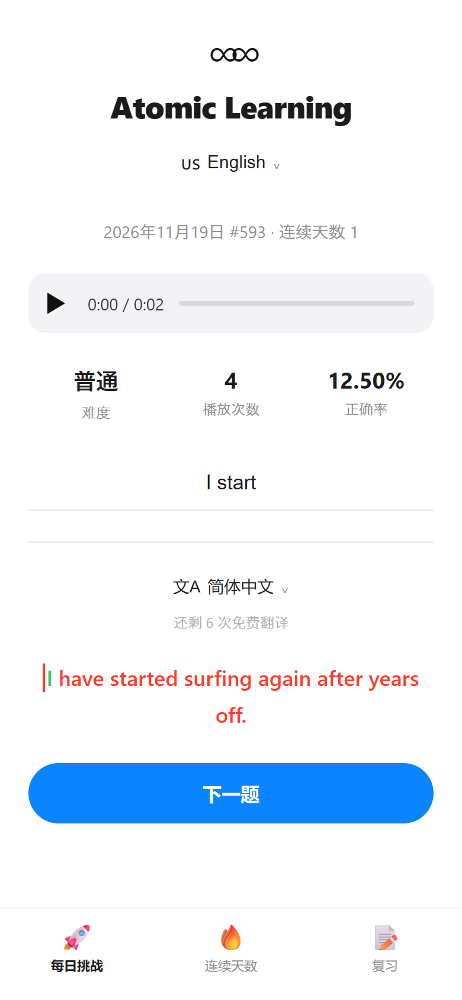
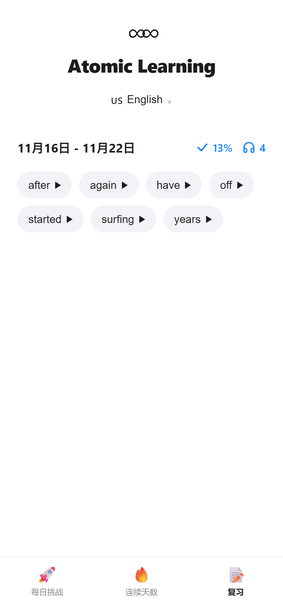
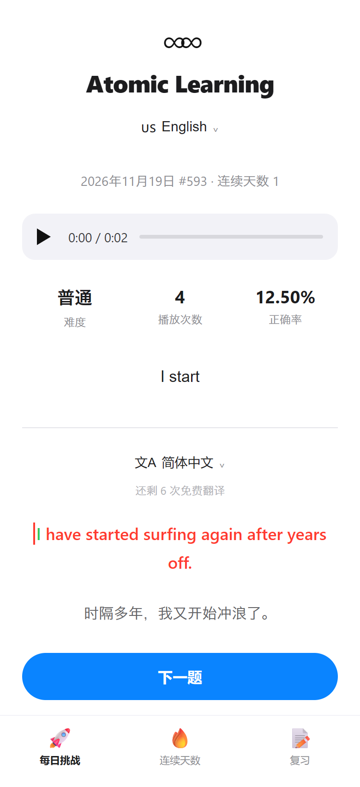
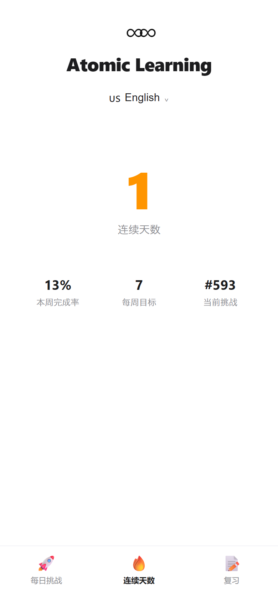
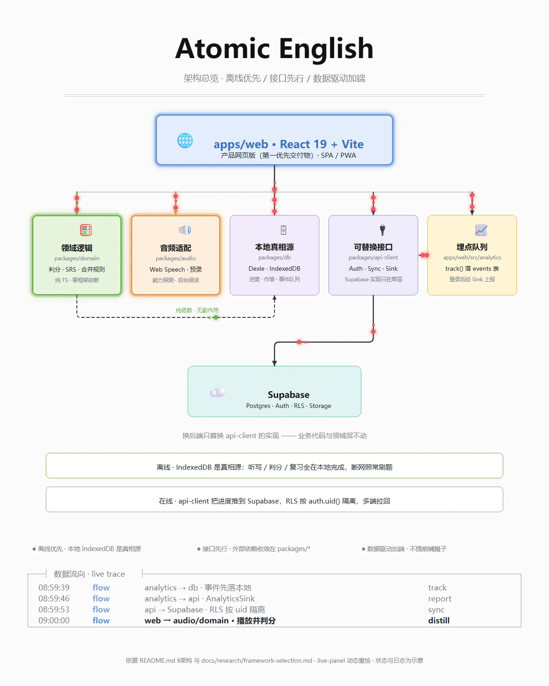

<div align="center">

# Atomic English

**听一句话，写出来，第二天再复习一遍。**
一个把「每日听写 → 逐词判分 → 间隔复习」跑成完整闭环的开源学习应用。

[](https://github.com/most-silence/atomic-english/actions)
[](LICENSE)
[](https://react.dev)
[](docs/research/pwa-audio-spike.md)
[](https://supabase.com)
[](scripts)

</div>

---

## 为什么做这个

背单词的 App 很多，但「听懂一句话并能拼写出来」这件事，几乎没有产品把它做成每天 2 分钟的习惯。Atomic English 参考公开的界面截图归纳出通用的行为规则（判分算法、复习词条抽取、进度派生），再用自己的技术栈独立实现，并逐步补齐 PWA、音频、云同步。项目不复用任何第三方商业软件的代码、商标或设计资产。

设计上只有三条硬规矩：

1. **离线优先**：本地 IndexedDB 是真相源，云端只做备份与多端同步。断网照样刷题。
2. **接口先行**：领域逻辑与数据访问收敛在 `packages/*`，「加一个端」等于写一个新前端，而不是重做产品。
3. **数据驱动加端**：桌面/移动壳要等 web 端数据证明手机是主入口后才建，不提前铺摊子。

## 界面一览

<div align="center">

| 听写挑战（提交后逐词判分） | 复习词条 |
| :---: | :---: |
|  |  |

| 初始状态（等待作答） | 连续天数 |
| :---: | :---: |
|  |  |

</div>

判分不是模糊的「差不多」：`I start` 对原句 `I have started surfing again after years off.` 只命中 `I`，得 **12.50%**（1/8），`start ≠ started`，不做词干归一。错词按字母序进入复习队列，再按 SRS 间隔推进。这些规则都有示例和数值验证，见 [行为观察笔记](docs/research/reference-behavior-notes.md)。

## 核心能力

- **每日挑战**：30 道日常英语题库，播放 → 听写 → 逐词高亮判分 → 真实翻译 API（每日 6 次额度，成功才扣减）
- **间隔复习**：只入库答错的实词，词级听写判分后按表现推进 SRS（1/2/4 天）
- **进度派生**：连续天数、周完成率全部从真实完成日期推导，不存冗余状态
- **离线可用**：PWA 安装 + Service Worker 应用壳缓存，断网重载照常进入挑战
- **音频适配**：Web Speech 起步，含 iOS 手势解锁、后台保活、长句切片与 `onend` 看门狗；预录音频走 Cache API
- **云同步**：Supabase Auth + Postgres，本地优先、按 `auth.uid()` 的 RLS 隔离、跨设备拉取进度
- **可观测**：安装漏斗、音频解锁、离线/更新等事件先落本地队列，登录后上报云端

## 快速开始

### 方式 A：Docker（推荐，日常使用）

**一条命令拉起全栈**，本机不需要 Node/pnpm 跑服务：

```bash
git clone https://github.com/most-silence/atomic-english.git
cd atomic-english
bash scripts/start-docker.sh
```

脚本会依次：启动 Supabase 后端（Docker 容器）→ 读取 Publishable key 写入 `.env.docker` → 构建并启动前端容器。完成后访问：

- 前端：http://localhost:8080
- 诊断页：http://localhost:8080/?diag=1
- Supabase Studio：http://localhost:54323

前端镜像把 Supabase 地址与 key 作为**运行时配置**注入（`/config.js`），所以同一个镜像换环境不用重新构建。想改端口或后端地址，编辑 `.env.docker`（复制自 [`.env.docker.example`](.env.docker.example)）后 `docker compose up -d --build`。

### 方式 B：本地开发（改代码时用）

```bash
# 环境：Node 22+、pnpm 12（corepack 启用）
corepack enable
pnpm install
pnpm dev            # 打开 http://127.0.0.1:5173/
```

不配后端也能跑——这就是离线优先的好处：所有学习数据存本地 IndexedDB，登录入口在配置后端后才出现。需要后端时：

```bash
pnpm exec supabase start          # 后端本身就是 Docker；镜像已缓存则不再下载
cp apps/web/.env.example apps/web/.env.local
# 把 supabase start 输出的 Publishable key 填进 .env.local
pnpm dev
```

数据库表与 RLS 在 [`supabase/migrations/`](supabase/migrations/)。部署、持久化、备份细节见 [`docs/deployment.md`](docs/deployment.md)。

## Android 端

Android 端是 Capacitor 壳，复用同一份 Web 构建产物（不另写原生 UI）。构建 APK 详见 [`docs/android.md`](docs/android.md)：

```bash
pnpm android:build      # build web → cap sync → gradlew assembleDebug
```

需要 Android SDK（Platform 36 + Build Tools 36）与 JDK 21；产物在 `apps/mobile/android/app/build/outputs/apk/debug/app-debug.apk`。

## 架构

<div align="center">



<sub>数据流随 6 个阶段循环高亮；状态与日志为示意。配置见 [`config.json`](docs/assets/architecture/config.json)，重新出图用 `scripts/build-architecture-panel.py`。</sub>

</div>

关键分层：

| 目录 | 职责 |
| --- | --- |
| `apps/web` | 产品网页版（第一优先交付物） |
| `packages/domain` | 纯 TS 领域逻辑：判分、SRS、进度、**同步合并规则** |
| `packages/db` | Dexie 本地持久化：进度、作答、复习词条、埋点队列 |
| `packages/audio` | Web Speech / 预录音频适配，能力探测与后台保活 |
| `packages/api-client` | `AuthClient` / `SyncClient` / `AnalyticsSink` 接口与 Supabase 实现 |
| `scripts/` | 图标生成、UI/PWA/后端/云端四套验证脚本 |

换后端只需替换 `api-client` 的实现，业务代码不动。这条纪律让 Supabase → 自托管 FastAPI/Django 的迁移成本被锁在单层里。

## 验证

项目用真实浏览器和真实后端验证，不靠「看起来对」：

```bash
pnpm typecheck          # 全包类型检查
pnpm test               # 63 个单测（domain 45 + audio 14 + api-client 4）
pnpm build              # 生产构建
pnpm verify:ui          # 阶段一：9 环节全流程（Playwright + 系统 Chrome，390px 视口）
pnpm verify:pwa         # 阶段二：10 环节 PWA + 音频 spike
pnpm verify:backend     # 后端：栈可达/注册登录/三表读写/RLS 隔离/幂等
pnpm verify:cloud-ui    # 云端：注册→答题→自动同步→另一浏览器登录拉回进度
pnpm verify:persistence # 持久化：临时用户当天缓存/跨天重置 + 注册后跨设备拉回
pnpm verify:mobile     # 手机浏览器：命中区/溢出/字号/横屏/视口适配
```

后三项需要先启动本地 Supabase 栈并填好 `.env.local`。`verify:persistence` 还覆盖「注册后立刻答题」的同步竞态：pull 期间重新读本地快照再合并，避免刚写入的进度被空快照覆盖。端到端脚本都用真实交互而非 DOM 快照断言，并校验零控制台错误。

## 技术选型

| 领域 | 选择 | 理由 |
| --- | --- | --- |
| 框架 | React 19 + Vite 8 + TypeScript 5.9 | SPA 起步，避免 RSC 耦合 |
| 构建 | pnpm workspaces + Turborepo | 多包任务图与缓存 |
| 本地存储 | Dexie 4 / IndexedDB | 离线优先的真相源 |
| 音频 | Web Speech API（起步）+ Cache API | 零依赖零成本，预录路径已留接口 |
| 后端 | Supabase（Postgres + Auth + RLS） | 强关系数据、开源可自托管、逃生舱完整 |
| PWA | 手写 Service Worker | 四类请求分层缓存，无构建期依赖 |
| 部署 | EdgeOne Pages 主站 + Cloudflare 镜像 | 大陆可访问性是硬约束，见 [部署调研](docs/research/framework-selection.md) |

完整权衡与一手来源在 [`docs/research/framework-selection.md`](docs/research/framework-selection.md)。

## 路线图

| 阶段 | 状态 | 内容 |
| --- | --- | --- |
| 一 · Web MVP | ✅ | 听写闭环、SRS 复习、进度派生、云同步 |
| 二 · PWA 加固 | ✅ 工程 / ⏳ 验收 | manifest、SW、安装引导、音频 spike、埋点；真机验证待做 |
| 三 · 移动壳 | ⏳ 门槛未到 | 数据证明手机是主入口后才做 Capacitor 壳 |
| 四 · 桌面壳 | ⏳ 门槛未到 | 有文件系统/脱机刚需后再做 Tauri 壳 |

阶段二的真机验证清单、端侧工具链调研见 [`docs/research/pwa-audio-spike.md`](docs/research/pwa-audio-spike.md)。**不提前加端**是明确的纪律。

## 贡献

Issue 走 GitHub Issues，按 `area:*` 标签分轨（web / website / backend / shared…），triage 状态机与 wayfinder 标签见 [`docs/agents/`](docs/agents/)。欢迎从「good first issue」开始，或直接提 PR——附带对应验证脚本的输出会大幅加快合并。

```bash
pnpm test && pnpm verify:ui && pnpm verify:pwa   # PR 前请跑这三套
```

## License

MIT © Atomic English contributors
